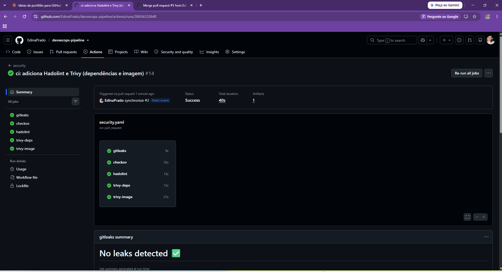
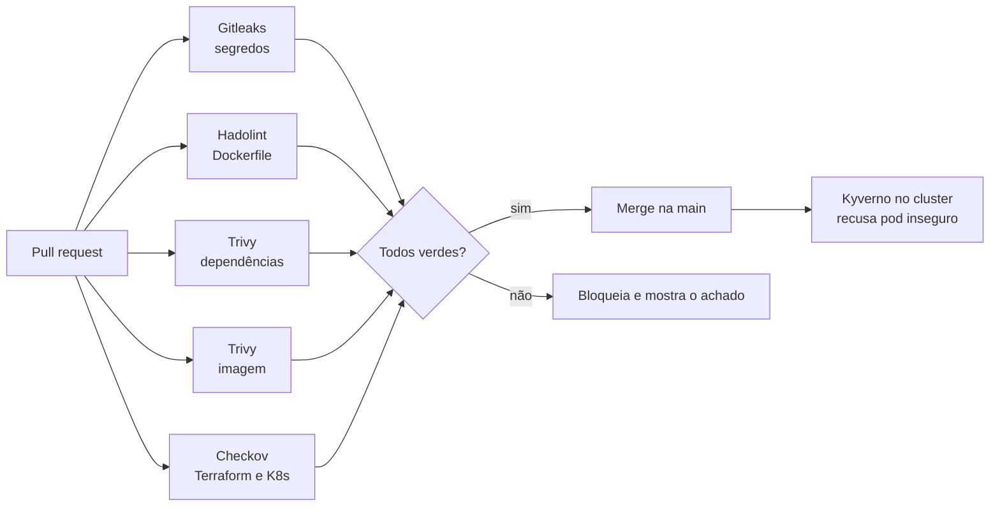
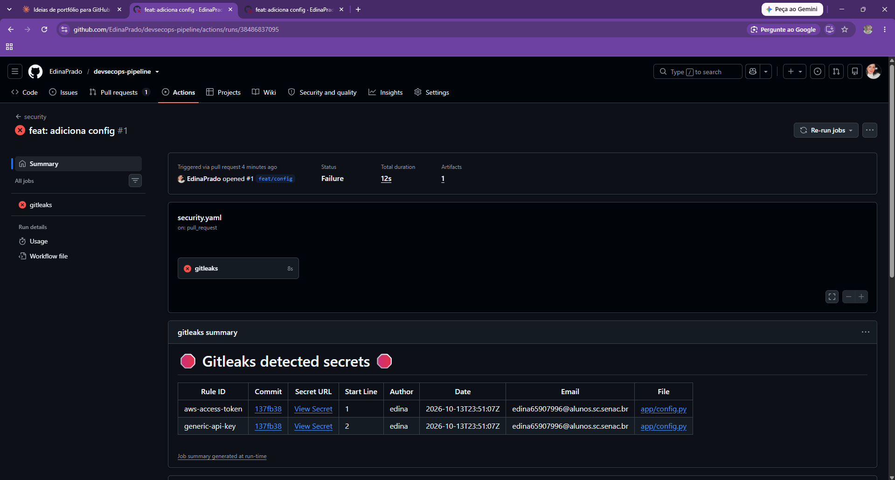
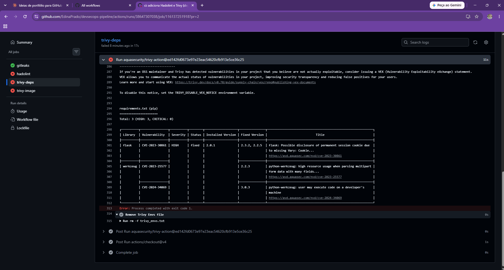
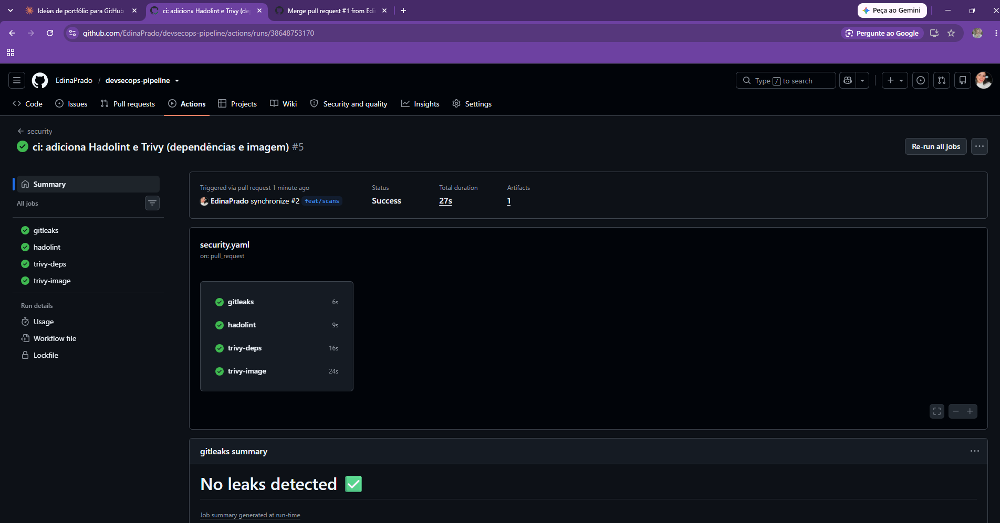
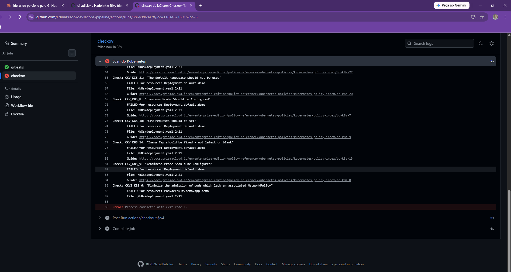
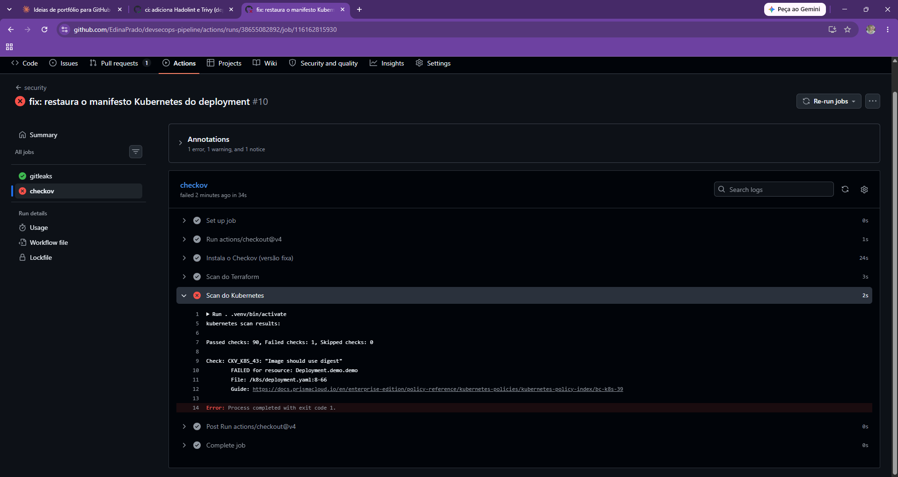

# DevSecOps Pipeline

Pipeline de segurança em camadas para código, containers, infraestrutura como código e Kubernetes. Cada pull request passa por cinco verificações automáticas no GitHub Actions, e o cluster ainda tem uma última barreira com **Kyverno**, que recusa workloads inseguros na hora do `kubectl apply`.

O repositório parte de arquivos **vulneráveis de propósito** e conta a história completa: o pipeline falha, os achados são lidos e corrigidos, e o pipeline passa.



## Camadas de proteção



| Camada | Ferramenta | O que verifica | Quando roda |
|---|---|---|---|
| Segredos | Gitleaks | chaves e tokens no histórico do Git | PR e push na main |
| Dockerfile | Hadolint | más práticas de build | PR e push na main |
| Dependências | Trivy (fs) | CVEs HIGH e CRITICAL no `requirements.txt` | PR e push na main |
| Imagem | Trivy (image) | CVEs na imagem construída | PR e push na main |
| IaC | Checkov | Terraform e manifests Kubernetes | PR e push na main |
| Cluster | Kyverno | privilégio, root, tag `latest`, sem limites | no `kubectl apply` |

## Estrutura

```
.
├── app/                    # app Flask e Dockerfile
├── terraform/              # S3 e security group (só escaneados, nunca aplicados)
├── k8s/                    # Deployment, ServiceAccount e NetworkPolicy
├── policies/               # ClusterPolicies do Kyverno
├── .github/workflows/
│   └── security.yaml       # os cinco jobs de segurança
└── docs/                   # evidências (prints)
```

## A história: antes e depois

### 1. Segredos (Gitleaks)

Um PR com uma chave AWS falsa em `app/config.py` foi barrado. O Gitleaks encontrou dois segredos: um `aws-access-token` e um `generic-api-key`.


Apagar o arquivo em um commit novo não resolve, porque o scan olha o histórico do PR. A correção foi reescrever o commit (`git commit --amend`) e fazer force push.


> Num caso real, uma chave que chegou ao GitHub precisa ser **revogada e trocada**, mesmo depois de limpar o histórico.

### 2. Dockerfile, dependências e imagem (Hadolint e Trivy)

Os três jobs falharam no primeiro run:



- **Trivy (dependências):** 3 achados HIGH. Flask 2.0.1 (CVE-2023-30861) e Werkzeug 2.0.1 (CVE-2023-25577 e CVE-2024-34069). A versão corrigida mais alta exigida era a 3.0.3.



- **Hadolint:** `DL3042`, pip usando cache.


- **Trivy (imagem):** reprovou a imagem de base `python:3.9`.

Correção: base `python:3.12-slim`, `pip install --no-cache-dir`, usuário não-root e `flask==3.0.3` com `werkzeug==3.0.3`.



### 3. Terraform e Kubernetes (Checkov)

| Alvo | Antes | Depois |
|---|---|---|
| Terraform | 7 passaram, **11 falharam** | 23 passaram, **0 falharam**, 4 pulados |
| Kubernetes | 69 passaram, **20 falharam** | 90 passaram, **0 falharam**, 1 pulado |






Os achados corrigidos incluem ACL pública e falta de criptografia no bucket, SSH aberto para `0.0.0.0/0`, container privilegiado, execução como root, ausência de limites de recursos e de NetworkPolicy.

As exceções (`skip`) foram **registradas no próprio código com justificativa**, em vez de silenciar a ferramenta: logging do S3, replicação entre regiões, notificações de eventos, security group sem anexo e imagem por digest.

### 4. Kyverno no cluster

Mesmo com tudo verde no CI, alguém pode tentar aplicar um manifesto inseguro direto no cluster. As quatro políticas (`disallow-privileged`, `require-run-as-non-root`, `disallow-latest-tag` e `require-resource-limits`) rodam em modo `Enforce`.

O manifesto vulnerável do commit inicial foi **recusado** pelo admission webhook:


O manifesto corrigido foi **aceito**:


## Decisões de projeto

- **Actions de terceiros fixadas por hash de commit.** O release do `trivy-action` passou por um incidente de supply chain, e uma tag pode ser redirecionada. O hash não pode. O Hadolint roda pela imagem oficial com versão fixa, e o Checkov pelo `pip` com versão fixa, sem action de terceiros.
- **Exceções com justificativa.** Um `skip` sem explicação esconde risco. Cada exceção deste repo diz por que foi aceita.
- **Terraform nunca é aplicado.** Os arquivos existem só para serem escaneados, então não há custo nem exposição na AWS.
- **Defesa em camadas.** O Hadolint não enxerga container rodando como root quando o `USER` não está declarado. Quem cobre isso é o Checkov nos manifests e o Kyverno no cluster.

## Lições aprendidas

- **Verde pode ser falso.** Em um momento o scan de Kubernetes passou porque o arquivo de manifesto tinha sido sobrescrito por engano e o Checkov não encontrou nenhum recurso. Um scanner sem alvo termina com sucesso. Vale conferir que `Passed checks` é maior que zero.
- **Corrigir só o que o scanner mostrou não basta.** A primeira correção cobriu os achados visíveis, e o relatório novo mostrou o que faltava. O ciclo é falhar, ler, corrigir e repetir.

## Como rodar localmente

Hadolint (igual ao CI):
```bash
docker run --rm -i hadolint/hadolint:v2.12.0 < app/Dockerfile
```

Checkov (igual ao CI):
```bash
python3 -m venv .venv && . .venv/bin/activate
pip install checkov==3.2.508
checkov -d terraform --framework terraform --compact --quiet
checkov -d k8s --framework kubernetes --compact --quiet
```

Kyverno em um cluster kind:
```bash
kind create cluster --name devsecops
helm repo add kyverno https://kyverno.github.io/kyverno/ && helm repo update
helm install kyverno kyverno/kyverno -n kyverno --create-namespace --version 3.7.2
kubectl apply -f policies/baseline.yaml
```

## Próximos passos

- [ ] Enviar os resultados em SARIF para a aba **Security** do GitHub
- [ ] Fixar também `actions/checkout` e `gitleaks-action` por hash
- [ ] Dependabot para atualizar versões fixadas
- [ ] Testes das políticas com o Kyverno CLI no CI
- [ ] Verificação no pipeline de que o Checkov analisou pelo menos um recurso
- [ ] Proteção de branch exigindo os cinco checks verdes